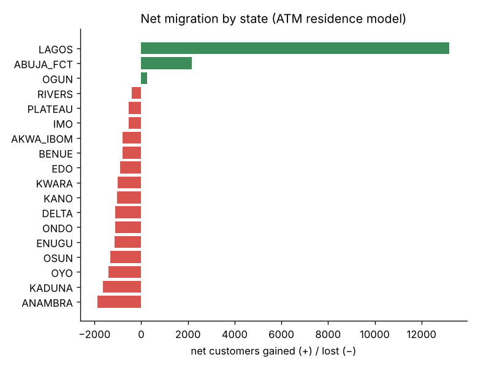
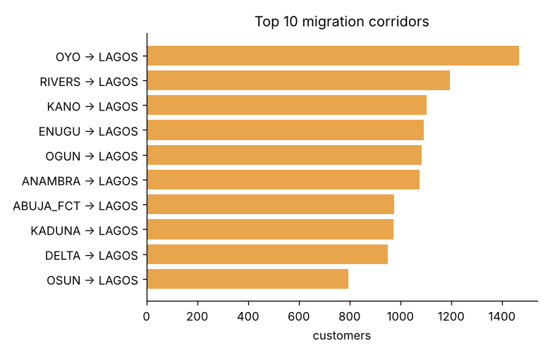

# Customer Residence Inference (CRI)

[](https://github.com/SMLRE/customer-residence-inference/actions/workflows/ci.yml)

Infers where customers **actually live and move**, based on branch visits, ATM withdrawals and card/POS activity, instead of the stale address captured at account opening.

> **About the data.** This is a public re-implementation of a model I built and presented at a Nigerian commercial bank. Customer data is **not** in this repo. The code runs on synthetic footprints with the same structure. The "In production" section reports the real findings. Results after it come from the synthetic data.



## In production: real findings (Jun 2026)

| | |
|---|---|
| **Customers analysed** | **1.54 million** |
| **Relocated from account-opening state** | **83%** |
| **Lagos** | **Net inflow of 1.24 million customers**, by far the dominant destination |
| **Confidence** | **90.4%** of inferences rated HIGH confidence |
| **Corridors** | **All top-10 migration corridors point to Lagos** |
| **Delivered** | 20-slide executive deck. The image-only slides were later rebuilt as fully editable PowerPoint |

**How the model evolved**

* **V1:** one weighted model (branch visits weight 2, card/POS weight 1). This produced the findings above.
* **Final design:** branch visits and ATM visits run as **fully separate, independent models, with no blending**.
  * **Branch = mobility signal:** where the customer is during the day.
  * **ATM = local convenience signal:** where the customer lives.

Blending the two had put commuters in the wrong state. This repo reproduces both versions and shows why the split matters.

## Approach

| Step | Where |
|---|---|
| Location signals: events per customer × state × channel over 12 months | `sql/01_state_signals.sql` |
| V1 blended weighted model + confidence tiers | `sql/02_v1_weighted_model.sql` |
| Final design: independent branch and ATM models | `sql/03_separate_models.sql` |
| Migration corridors (opening state → inferred state) | `sql/04_corridors.sql` |

Confidence: **HIGH** when the winning state holds at least 60% of the evidence with enough volume, **MEDIUM** at 45% or more, otherwise **LOW**.

## Results on the synthetic reproduction

The generator was calibrated so the real headline pattern appears again: **83.7%** relocated, **~90%** HIGH confidence, **Lagos** the top net gainer, and **all top-10 corridors ending in Lagos**.



**Why separate models.** The synthetic data has a hidden true residence, which production never has, so the design choice can be tested directly. Take Ogun residents who commute to Lagos:

| Model | Correctly placed in Ogun |
|---|---|
| V1 weighted blend | 84% |
| Branch model | 61% (places them at *work*, by design) |
| **ATM model** | **99%** |

The two final models disagree for about 5% of customers. Those are the commuters, and they are a useful segment in their own right.

*Accuracy on synthetic data is optimistic by construction. The point is the direction of the comparison, not the absolute level.*

## Run it

```bash
pip install -r requirements.txt
python run_pipeline.py
```

## Repo layout

```
data/generate_synthetic.py     30k customers; migration towards Lagos; commuters; trips home
sql/01..04_*.sql
src/cri.py                     runs models, relocation summary, corridors, synthetic-only accuracy
run_pipeline.py
notebooks/walkthrough.ipynb
```

## Author

**Oluwasemilore Sadare**, Data Scientist · [LinkedIn](https://www.linkedin.com/in/oluwasemilore-sadare) · [GitHub](https://github.com/SMLRE)
